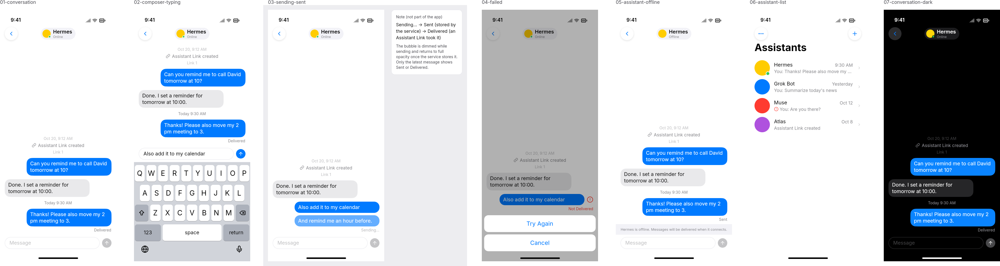
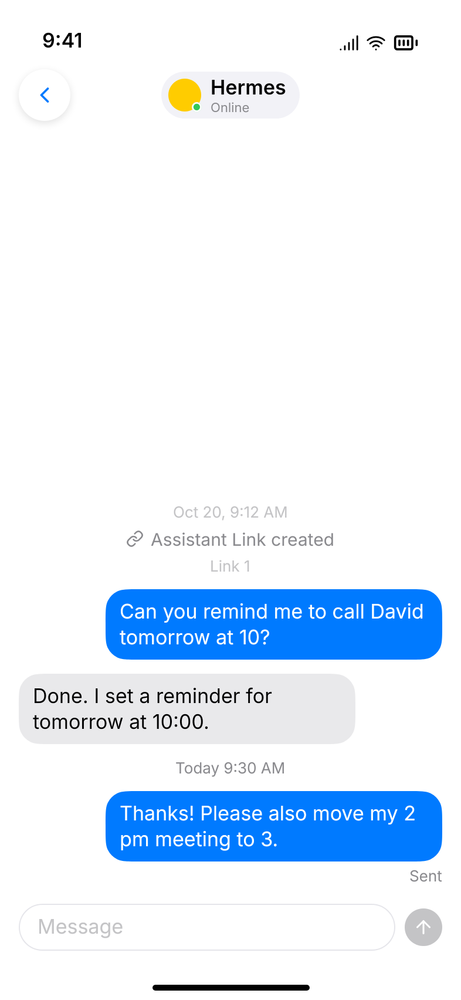
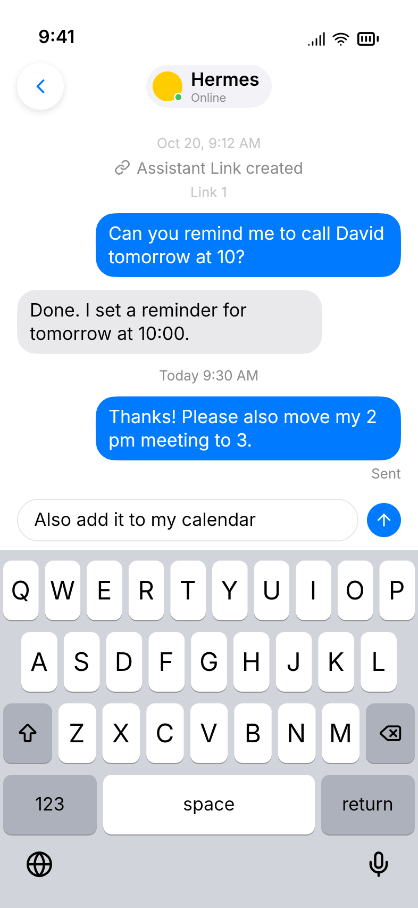
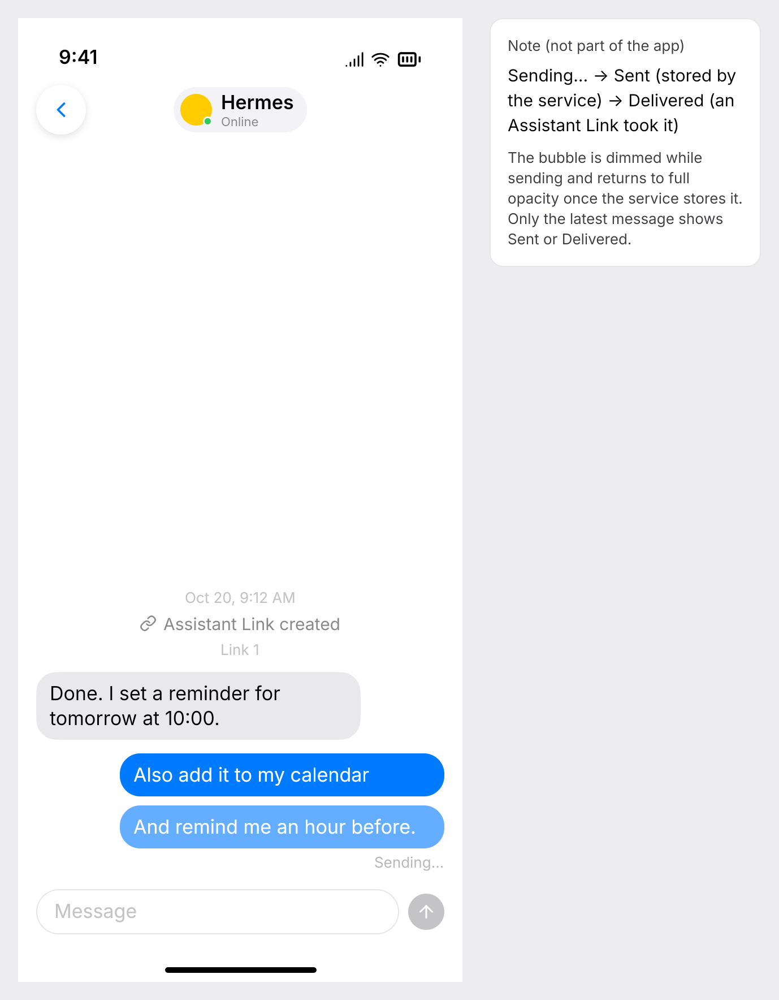
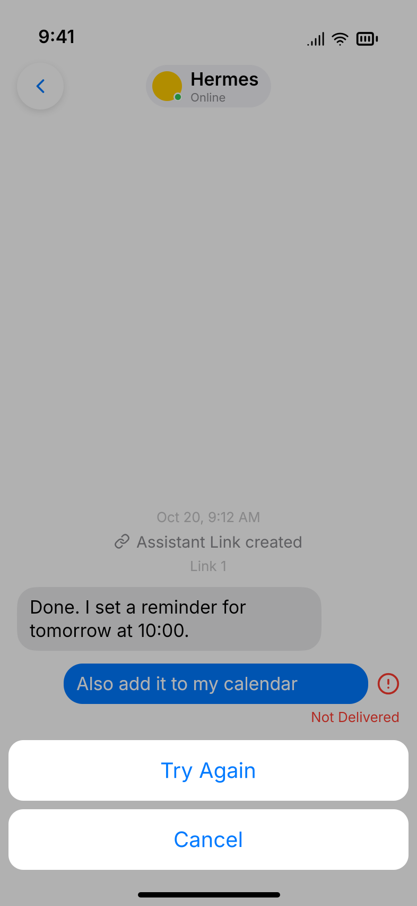
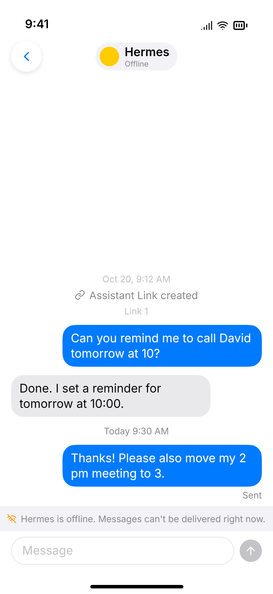
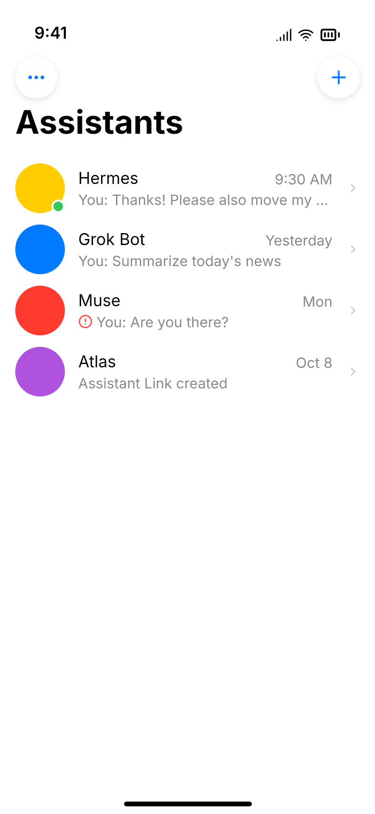
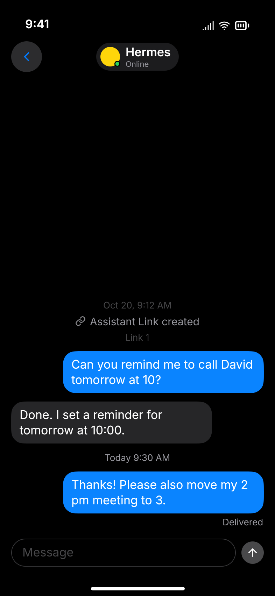

# Design

## Context

The Assistant Link service, `al`, and the app can connect an agent to an Assistant and show whether it is online. See `proposal.md` for the slice and `specs/` for the required behavior. Today:

- The app derives "Assistant Link created" events from the Assistants list; the service stores no Timeline. An event's time comes from its Link's UUIDv7 id. After this change the service stores the Timeline and the app derives nothing.
- The agent connection (`/alp/v1/connect`) is a JSON-RPC 2.0 WebSocket. Each connection is one process that tracks itself in `Phoenix.Presence`. The service sends only notifications, and `al wait` answers any request with `-32601`.
- The app's live connection (`/api/v1/connect`) is a JSON-RPC 2.0 WebSocket that forwards `link.status` notifications for the account.

Three principles shape the choices: use established protocols, keep the agent side free of state (`al` keeps nothing on the host), and build the delivery path once so later event types reuse it.

## Decisions

### The delivery retention, and the Timeline
The service stores every event of an Assistant's Timeline, including each message the user sends, and keeps the user's messages available for delivery to Assistant Links for **the delivery retention: 7 days** after they were sent. It is a single service setting with that default; tests set it to seconds. Every other mention of "7 days" in these artifacts means this value. It is unrelated to **the deletion grace period** (60 days, see "Log out: soft delete and purge").

The Timeline (the app's conversation history) is separate: it keeps events until the account is purged. The retention only bounds what an Assistant Link can still receive and catch up on, and when an undelivered message shows "Not Delivered". It is a condition on the event's `inserted_at` in queries; no row is deleted.

*Alternative:* expire the Timeline after 7 days too. Simpler storage story, but the conversation would silently shrink (open question 1).

### Log out: soft delete and purge
Log out no longer deletes rows. It sets `accounts.deleted_at` (`timestamptz`, null by default) with `UPDATE accounts SET deleted_at = now() WHERE id = $id AND deleted_at IS NULL` and then broadcasts `:account_deleted` on the account's topic as today, so connected agents and app connections get `connection.closing` with reason `account_deleted` and close. Device rows, users, and every owned row stay until the purge, except the web tokens below. A second log out cannot happen (its credential is already rejected), and `deleted_at IS NULL` keeps `deleted_at` from moving forward.

**Where the check lives.** Every lookup of the account excludes a deleted one:

- Device credential lookup (`Accounts.get_scope_by_device_token/1`) and web session scope building (`Accounts.scope_for_user/1`, which already finds the user's one account): the join on `accounts` adds `deleted_at IS NULL`. A device of a deleted account is unauthorized (`401`); a web session whose only account is deleted gets no scope and does not act in it. Log out also deletes, in the same transaction as the UPDATE, the `users_tokens` (sessions and magic-link tokens) of every user whose only account is the deleted one, so their web sessions and magic links stop working at once; a later password login of such a user gets no scope (`scope_for_user` returns nil). Their email stays taken until the purge (open question 7: accepted; anonymous app users have no email).
- Link token lookup (`Links.get_link_by_token/1`) adds `deleted_at IS NULL` through the Link's account, so a Link token is `401 unauthorized`. `Links.pair/1` already locks the Link row in its transaction, to reject a code replaced or used concurrently; it checks `deleted_at` inside that transaction, after locking the Link, not as a pre-check, and rejects a deleted account's pairing code like an unknown code (`invalid_code`).
- Posting (client API and `POST /alp/v1/messages`) is behind those lookups; it needs no check of its own.
- Delivery: the broadcast closes every connection of the account and none can reopen without a valid Link token. A connection subscribes to the account topic first and then authenticates and re-checks `deleted_at IS NULL`, so a log out racing with connection setup cannot be missed. The delivery query also requires `deleted_at IS NULL` through the Link's account, so a delivery process never starts sending a deleted account's event even if a broadcast is missed. An `event.deliver` already in flight at the moment of deletion may still complete; its acknowledgement is harmless.

**The purge.** A supervised process, `AssistantLink.Accounts.Purger`, calls `Accounts.purge_deleted_accounts/0` on a fixed interval (hourly, open question 7). The function purges account by account, each in its own transaction, so a backlog never becomes one huge transaction. Each transaction claims one account row with `SELECT … FOR UPDATE SKIP LOCKED` where `deleted_at < now() - the deletion grace period`, so concurrent runs on several nodes skip each other's accounts. It deletes only that one account and what it owns, never any other account, explicitly and in dependency order (children first), without relying on the database to resolve any cascade:

1. collect the ids of the account's users from its `memberships`, and lock the account row (`FOR UPDATE SKIP LOCKED`, as above);
2. the `text_messages` of the account's events;
3. the account's `assistant_events`;
4. the account's `pairing_codes`;
5. the account's `assistant_links` (Link tokens are the `token_hash` column of this table, and the cursors are columns on it);
6. the account's `assistants`;
7. the account's `devices`;
8. the account's `memberships`;
9. the `accounts` row;
10. for each collected user who now has no membership left in any account, whether or not the user has an email: that user's `users_tokens` (and any `devices`, though none can remain, since a device needs a membership), then the `users` row.

A user in two accounts purged together is therefore deleted with the second one; a user still in an active or in-grace account is kept, and that account is untouched. A partial index `accounts (deleted_at) WHERE deleted_at IS NOT NULL` keeps the claim query cheap, since almost every account has it null. The owner trigger does not get in the way: `account_has_owner_on_insert` is AFTER INSERT only, so the soft-delete UPDATE does not fire it, and `account_keeps_owner` is deferred and passes because the account row is gone at commit.

A crash or a second run is harmless: an account is either purged in its transaction or untouched. **The deletion grace period** is a single service setting (config key `:deletion_grace_period`), default 60 days, settable in seconds in tests.

The app keeps its two confirmations and the "Delete Everything" button. Its second alert stays as it is ("Logging out permanently deletes all your Assistants, Assistant Links, and history. This can't be undone."), by the product owner's choice: for the user the data is gone at once and can't be recovered. The service-side purge after the deletion grace period is unaffected.

There is no undelete (see non-goals).

*Alternative:* delete rows at log out, as before. Rejected: the product wants a grace period before data is erased.

*Alternative:* run the purge from Oban cron. It would add a dependency and a table for one hourly DELETE; a supervised process is enough. Revisit when other scheduled jobs exist.

### No cascades: the purge deletes in order
No foreign key the purge relies on has an `ON DELETE` action (the default, `NO ACTION`). The purge is the only deleter of accounts and of everything they own, so deleting explicitly in order keeps every deletion visible in code, and lets the database reject a deletion that missed a child (a foreign key violation) instead of silently removing it. The existing foreign keys defined with `ON DELETE CASCADE` are replaced by the migration in task 1.13: `users_tokens.user_id` → `users`; `memberships.account_id` → `accounts`; `memberships.user_id` → `users`; `devices (account_id, user_id)` → `memberships (account_id, user_id)`; `assistants.account_id` → `accounts`; `assistant_links (account_id, assistant_id)` → `assistants`; `pairing_codes (account_id, link_id)` → `assistant_links`. The only code that relied on the cascade was the old hard-delete log out, which this change replaces. Deleting a single Link is not part of this slice; it will be planned later.

*Alternative:* keep the cascades. Rejected: the purge would depend on the database to remove most of the data, and a forgotten child would go unnoticed.

**Names** (reviewed and decided): `accounts.deleted_at`; the deletion grace period and its config key `:deletion_grace_period`; `Accounts.purge_deleted_accounts/0`; the process `AssistantLink.Accounts.Purger`; the partial index on `accounts (deleted_at)`; the event field `deleted`; `created_at` (replacing `sent_at` on events and in the `POST /alp/v1/messages` response); the nested content key named after the event type (e.g. `text_message`); the command `al help`; the error code `no_paired_link`; the endpoint `GET /alp/v1/link`; the field `unread_count`; the `event.deliver` result field `event_id`. The reason `account_deleted`, `401 unauthorized`, and `idempotency_key` keep their names.

### Events and the per-Link stream
An **event** is one item of an Assistant's Timeline, stored as one row of `assistant_events`. The service delivers some of them to Assistant Links as `{"id", "type", "created_at", "deleted", "<type>": {…}}`: the common envelope fields plus the content nested under a key named after the type. `id`, `type`, `created_at` (the event's creation time), and `deleted` (a boolean) are always present; the content key is per type. This slice has two types: `link_created` (a Link was created; sender `system`; no content key; never delivered) and `text_message` (content `{"text"}`). Only the user's `text_message` events are delivered, a deleted one included: it has `"deleted": true` and no content key. The ALP `type` value is the stored type, `text_message`, not `message`: one name in the database, the protocol, and `al wait` lines, so later types need no mapping. The event `id` is the row's UUIDv7; order is its `seq` (see "The cursor").

Delivered events are covered by the cursor and caught up after a reconnect, within the retention. Later types (calls, audio, requests) add `type` values and reuse the same table, delivery, cursor, and `al wait` line format.

### Delivery to the agent: a JSON-RPC request, `event.deliver`
The service delivers an event with a request on an open agent connection whose params are the event, exactly the line `al wait` prints:

```json
{"jsonrpc": "2.0", "id": 7, "method": "event.deliver",
 "params": {"id": "0199…", "type": "text_message", "created_at": "2026-10-22T09:30:00Z", "deleted": false, "text_message": {"text": "Hi"}}}
```

The agent's response is the acknowledgement: `{"jsonrpc": "2.0", "id": 7, "result": {"event_id": "0199…"}}`. JSON-RPC request ids are plain per-connection counters on each side (the service numbers its own requests, `al` its own), used only to pair a response with its request, never an event or other domain id. The event is acknowledged by the `event_id` in the result, whichever request or connection it came on; `result` is an object so later revisions can add fields. An error response, no response within 30 seconds (the *attempt timeout*), or a connection that closes first only fails the attempt. A result that arrives late for the event, even after the attempt timeout, is still its acknowledgement and cancels the retry; a late error after the event is acknowledged changes nothing. A response whose request id is unknown or expired completes no request (no timeout or error effect) and the connection stays open; but a `result` carrying an `event_id` is still passed to the delivery logic and acknowledges that event, so a late result after a timeout, or one on a new connection, counts. An error with an unknown request id is ignored.

An agent that predates this slice answers `-32601` (the existing forward-compatibility rule), so the event stays unacknowledged instead of silently vanishing. This is also why delivery is a request and not a notification: a notification could never tell "taken" apart from "lost".

*Alternative:* a `message.deliver` request specific to text messages. Rejected: every new event type would need its own method, ack rules, and cursor.

### The cursor: one per Assistant Link, owned by the service
The service tracks, for each Assistant Link, the `seq` of the last event the Link read and acknowledged (`assistant_links.last_read_seq`, a bigint). `seq` is a per-Assistant sequence assigned to every event in the transaction that stores it (see "Event storage"), so it follows commit order, which a UUIDv7 does not. The agent keeps no state and passes no position; this matches `al` keeping nothing on the host.

- **One unacknowledged event per Link at a time, in `seq` order.** The service sends the next event only after the previous one was acknowledged, so a single cursor is exact: everything up to it was taken, nothing after it was.
- **Acknowledgement advances the cursor.** The response to `event.deliver` sets the Link's cursor to that event's `seq` and sets the event's `delivered_at` if it is still null (below).
- **A lost acknowledgement means redelivery.** If the response never arrives (connection dropped, error, or the attempt timeout), the cursor stays and the same event is sent again, with the same `id`. Delivery is at least once; `al wait` drops the repeat (see "`al wait` event format"), and other readers dedupe by `id`.
- **Catch-up is the same mechanism.** After `connection.ready` the service sends the first deliverable event after the cursor, then the next after each acknowledgement, until none is left. Events that are not deliverable (see the query below), including those older than the retention, are skipped by the query; the cursor itself moves only by acknowledgement. New events are sent the same way once their transaction commits. `al` has nothing extra to implement.
- **A new Link starts at its pairing time.** The pairing transaction reads `assistants.last_event_seq` (no lock on the Assistant row) and sets `last_read_seq` to it. A message sent before the pairing is not delivered to the new Link and one sent after is; one sent at the same moment may arrive either way. An unpaired Link has no token and no connection, so it receives nothing anyway.
- **Several connections of one Link share its cursor.** The newest open connection receives the event. If it answers with an error, closes, or times out, the service tries the next-newest one that has not failed this round; after every open connection failed a round, it waits 30 seconds, doubling after each failed round up to 5 minutes, and starts over. A new connection resets the wait and starts a round at once. An event is never sent to two connections at once, but a connection may have written the line before it failed, so the next one can write it again (at least once).
- **Links are independent.** Each Link of the Assistant has its own cursor and its own pace: a slow or broken Link never holds back another.

A **delivery process** per online Link does this. A connection starts or attaches to the Link's process (a `DynamicSupervisor`, registered under a `:global` name keyed by `link_id`, so there is one per Link across nodes) atomically, restarting it if it is stopping. The process stops only after its last connection closed and an idle check, so a connection opening meanwhile is never left without one. It holds the one event in flight, the connections already tried, and a timer. It runs when a connection opens, when an "event stored" notice for the Link's Assistant arrives, on each acknowledgement, and when the timer fires; a notice triggers a query only when nothing is in flight and no backoff timer runs. The notice is broadcast on PubSub after the storing transaction commits, so it reaches the owning node, and an event stored while the process is starting is found by its first query. The query runs over `assistant_events`: `seq > last_read_seq`, sender `user`, a deliverable type (`text_message` in this slice; `link_created` is never delivered), `inserted_at` within the retention, lowest `seq` first, limit 1. Before it resends the event in flight (on the retry timer or as the fallback to another connection), the process checks the retention again; an event now outside it is dropped from flight and the process moves on to the next query, and the cursor does not move (a `result` for it that arrives later is still accepted as its acknowledgement, see below). A restart loses nothing: the cursor is in the database. The cursor update is monotonic (`WHERE last_read_seq < $seq`), so a late or duplicate acknowledgement never moves it back. The service runs on one node today; this does not block more.

Each agent connection process already tracks itself in Presence under its `link_id`; it adds its pid and the time it opened to the Presence metadata. The delivery process sends `{:deliver, request}` to a connection process, which writes the frame and passes each response's result or error on to the delivery process. The connection process is the only writer to its socket, so ordering and liveness behave as today. Its request counter is the JSON-RPC layer's alone: a response with an unknown or expired request id completes no request and does not close the connection, a `result` with an `event_id` is still handed to the delivery logic, an error with such an id is ignored, and the delivery logic keeps no mapping from request ids to events. An error or a timeout only fails that attempt (fallback and backoff as above). A result acknowledges its `event_id` even late, after the service moved on, or after it dropped the event for passing the retention; acknowledging an already-acknowledged event does nothing, and a result whose `event_id` is unknown, belongs to another Link's Assistant, or is not deliverable to this Link is ignored (no error code). "Not deliverable to this Link" means an event of another Assistant, a type never delivered (`link_created`), or one with `seq` at or below the Link's starting position at pairing; it does not cover the retention, so a result for an event the retention dropped still acknowledges it.

*Alternative:* the agent passes a position when it connects (`al wait --since <id>`). Needs agent state and says nothing the service does not already know.

*Alternative:* several events in flight with an acknowledged range. A lost ack in the middle needs a per-event state; one at a time is exact and fast enough for text.

### Message states
Only one timestamp is stored: `assistant_events.delivered_at`, set by the first Assistant Link acknowledgement of a user event. What the app shows is derived:

| Shown           | Derived from                                                                                          |
| --------------- | ----------------------------------------------------------------------------------------------------- |
| "Sent"          | A user `text_message` the service stored, `delivered_at` null, `inserted_at` within the retention.    |
| "Delivered"     | `delivered_at` is set.                                                                                |
| "Not Delivered" | A user `text_message` with `delivered_at` null and `inserted_at` older than the delivery retention.   |

The app adds two states of its own that are never stored: "Sending…" (the post to the service is in flight, with no timer of its own: it lasts until the post is answered) and "Not Delivered" when the service answered with an error or the post failed for a real network reason (connection lost, the system request timeout), with "Try Again". If the stored event arrives over the live connection first (matched by `idempotency_key`), the message switches to "Sent".

- **`delivered_at` is first-write-wins.** The acknowledgement, keyed by the result's `event_id`, runs `UPDATE … SET delivered_at = now() WHERE delivered_at IS NULL`, so the first Link's acknowledgement counts and later ones change nothing. A `result` for an event the delivery process dropped because it passed the retention still counts as that event's acknowledgement when it arrives later: it sets `delivered_at` (Delivered wins over the derived Not Delivered), advances the cursor with the monotonic update, and, when the update changes a row, the service sends the app `event.updated`.
- "Not Delivered" after the retention is computed when the event is read; nothing is written or pushed when the retention passes, and the app shows it the next time it loads the event.
- Only the latest of the user's messages shows "Sent" or "Delivered", as Apple Messages does. "Sending…" and "Not Delivered" show on every message they apply to, because they need attention.
- A message that is Not Delivered because the retention passed is final: no "Try Again" (open question 3). A message the app could not send is retried by posting it again with the same `idempotency_key` (see "Client API").
- The API carries the derived value as a read-only `delivery_status` on the user's `text_message` events (`sent`, `delivered`, `not_delivered`; never stored), because the app does not know the retention setting.

### The agent sends over HTTP: `POST /alp/v1/messages`
```
POST /alp/v1/messages          Authorization: Bearer <Link token>
{"text": "Your reminder is set."}
→ 201 {"message_id": "0199…", "created_at": "2026-10-22T09:31:00Z"}
```

An optional `idempotency_key` (a UUIDv7 string, unique per Assistant Link) makes the request idempotent: a repeat returns `200` with the stored message and stores nothing (the insert's conflict rolls back the transaction, undoing the `last_event_seq` bump, and the stored event is then read). A repeated `idempotency_key` with a different text is rejected with `409 idempotency_key_conflict`; if the stored message's text was deleted, the repeat answers `200` with the stored (deleted) event without comparing text. It is additive within v1.

Errors use the HTTP error format: `422 invalid_params` (`text` missing or not a string, or a malformed `idempotency_key`), `422 text_empty` (empty or only Unicode White_Space characters), `422 text_too_long` (more than 4,000 Unicode code points), `422 invalid_params` also for text containing U+0000 (Postgres `text` cannot store it), `401 unauthorized`, `409 idempotency_key_conflict`, and, for the client API only, `422 no_paired_link` (a Link token implies a paired Link, so it does not apply to `POST /alp/v1/messages`). The service enforces the text rules; the app mirrors them to disable the send button, and `al` does not check the text (the service's limit can change).

Why HTTP and not a JSON-RPC method on the agent connection? `al send` is a short-lived process. If it opened its own agent connection it would flip the Link's presence to online for a moment (the app shows it live within 2 seconds), and, as the newest connection, it could be chosen to receive the user's messages and exit before reading them. An HTTP request touches neither. It also lets an agent send without holding a WebSocket at all, which is the common case for a script. The service accepts it from any valid Link token, whether or not the Link is online, and it does not change presence or last active time.

A message an agent sends is stored as a `text_message` event with sender `assistant` and shown in the Timeline. It is **not** delivered to the Assistant's other Links in this slice (open question 4): they are separate agent installations and the sending agent knows what it said. It would be a new event `type` later.

### `GET /alp/v1/link`, and `al status` over HTTP
```
GET /alp/v1/link          Authorization: Bearer <Link token>
→ 200 {"link_id": "0199…", "assistant_name": "Hermes", "unread_count": 2}
```

It answers who the Link is and how many deliverable events wait for it: the user's `text_message` events after the Link's `last_read_seq` within the delivery retention (the delivery query's conditions, counted instead of limited to one). `link_created` and older messages are not counted. Authentication and errors are those of `POST /alp/v1/messages` (`401 unauthorized` for a missing or unknown token or a deleted account). It only counts: it never reads, delivers, or acknowledges events, never moves the cursor, and does not touch presence or `last_active_at`. It is additive within v1.

`al status` calls only this endpoint and never connects, for the same reason as `al send` above: a short-lived WebSocket would become the newest connection and flicker the Link online.

### Event storage
One table holds everything in an Assistant's Timeline; the text of a message lives in its own table.

`assistant_events(id, account_id, assistant_id, seq, type, sender, link_id null, idempotency_key null, delivered_at null, inserted_at)`:

- `id`: UUIDv7, the API identifier. `created_at` in the API is `inserted_at`.
- `seq`: a per-Assistant bigint assigned to every event in its insert transaction with `UPDATE assistants SET last_event_seq = last_event_seq + 1 … RETURNING`, which holds a per-Assistant row lock until commit. Sequences therefore follow commit order; delivery order, Timeline order, and paging order are `seq`. `(assistant_id, seq)` is unique, which also serves the delivery query.
- `type`: `link_created` or `text_message`; later types add values. `sender`: `user`, `assistant`, or `system`.
- `link_id`: the Link the event came from (the Assistant's messages) or the Link created (`link_created`); null for the user's messages. It references `assistant_links` with no `ON DELETE` action; it is null only for events that never had a Link (the user's messages).
- `idempotency_key`: the sender's key, a UUIDv7 string validated by the service. Partial unique indexes: `(account_id, idempotency_key) WHERE sender = 'user' AND idempotency_key IS NOT NULL` and `(link_id, idempotency_key) WHERE sender = 'assistant' AND idempotency_key IS NOT NULL`. The user's key is unique per account, not per Assistant, and two Assistants' stores do not share a lock, so the insert is `ON CONFLICT DO NOTHING` on that index; when it hits an existing key the transaction rolls back (so the `last_event_seq` bump is undone and leaves no `seq` gap) and the stored event is then read: the same text and Assistant answer `200`, otherwise `409 idempotency_key_conflict`, never a `500`. If the stored event's text was deleted, the same Assistant answers `200` with the stored (deleted) event without comparing text, and another Assistant is `409`.
- `delivered_at`: the first Link acknowledgement; set only on the user's events.
- `(account_id, assistant_id)` references `assistants` with no `ON DELETE` action, so the purge deletes the account's events before its Assistants (see "No cascades: the purge deletes in order").

`text_messages(event_id primary key references assistant_events, text)` is the payload of a `text_message`, 1:1 with its event; `event_id` references `assistant_events` with no `ON DELETE` action, so the purge deletes the payloads before the events. `text` is stored as given (not trimmed, line breaks kept), 1–4,000 Unicode code points (scalar values), not only Unicode White_Space characters, and without U+0000 (rejected with `422 invalid_params`, because Postgres `text` cannot store it). The payload can be deleted on its own while the event stays as a deleted event: history and `latest_event` LEFT JOIN the payload, a `text_message` event without a payload row is a deleted event (`"deleted": true`, no content key), the app shows it as a neutral placeholder bubble ("This message was deleted"), and it is delivered like any other event. This slice has no way to do it; the split keeps it possible.

The cursor is one new column on `assistant_links`: `last_read_seq` (`bigint NOT NULL DEFAULT 0`, an event `seq`; pairing sets it to the Assistant's current `last_event_seq`). `assistants` gains `last_event_seq` (bigint, default 0).

**`link_created` is written when the Link is created**, in the same transaction, with sender `system`, `link_id` the new Link, and `inserted_at` the Link's creation time. The existing specs show the "Assistant Link created" event as soon as the Link exists, also for a Link that is not paired yet (its pairing text is reachable from that event), so it is not tied to pairing.

*Why store the Timeline in the service?* The Timeline is the per-Assistant history, and the app is a client of it; there is no local database in the app. Storing it durably also lets an offline Link catch up. The Timeline is per Assistant and stored by the service, so additional app devices of the same account (the service already has devices per account) could later read the same Timeline; multi-device stays a non-goal here.

### Client API
All under `/api/v1`, with the account credential:

- `POST /assistants/:id/messages` with `{"idempotency_key": "<UUIDv7>", "text"}` (the key is required and must be a UUIDv7; a missing or malformed one is `422 invalid_params`) → `201 {"message": event}` as soon as the event is stored; delivery happens afterwards. Repeating an `idempotency_key` already used returns `200` with the stored event in its current state and stores nothing; this is "Try Again", with no separate retry endpoint. The same key with a different text or Assistant is `409 idempotency_key_conflict`; if the stored event's text was deleted, the same Assistant gets `200` with the stored (deleted) event without a text comparison, another Assistant `409`. Text errors are `422` as above; an unknown Assistant is `404`. A post to an Assistant with no paired Assistant Link (no Links, or only unpaired ones) is rejected with `422 no_paired_link` and nothing is stored. The checks run in this order: authentication (`401`), unknown Assistant (`404`), an `idempotency_key` already stored for the account (`200` with the stored event, or `409 idempotency_key_conflict`, so a repeat of a stored key still answers `200` after the Links changed), invalid params or text (`422 invalid_params`, `text_empty`, `text_too_long`), then `no_paired_link`. `no_paired_link` is checked inside the storing transaction, which is enough: no extra lock. The app treats it like any other error response (Not Delivered, Try Again) with no special UI; it meets it only when the last paired Link goes away after the composer was shown.
- `GET /assistants/:id/events?limit=50&before=<event id>` → `{"events": [event], "has_more": bool}`, the newest `limit` events of any type (`link_created` included) older than `before` (or the newest of all; the service resolves `before` to that event's `seq` by lookup, and an unknown id or one of another Assistant is `422 invalid_params`), returned oldest first by `seq`. `limit` defaults to 50 and is at most 100. The history is read at `/events` and a text message is posted at `/messages`: the two paths differ because one returns events of every type and the other creates a text message.
- The Assistants list adds `"latest_event": event | null` to each Assistant: its latest event of any type, so the home screen needs no history. It is null only when the Assistant has no events.

An event is `{"id", "assistant_id", "type", "sender", "link_id", "created_at", "deleted", "delivery_status", "idempotency_key", "<type>": {…}}`: the same envelope as for agents (`id`, `type`, `created_at`, `deleted`, and the content nested under the type, e.g. `"text_message": {"text": "Hi"}`) plus `assistant_id`, `sender`, `link_id`, `delivery_status`, and `idempotency_key`. A `link_created` event and a deleted `text_message` have no content key. `delivery_status` (derived, see "Message states") is null except for the user's `text_message` events, and `idempotency_key` is null except for the user's. The app matches its local "Sending…" or "Not Delivered" bubble to the stored event by `idempotency_key`.

The app's live connection sends, to every app connection of the account:

- `event.created` with `{"event": event}` for every stored `text_message`, the user's too. The app that sent a user message matches it to its local bubble by `idempotency_key`; its other app connections append it.
- `event.updated` with `{"event": event}` when a message of the user gets its `delivered_at`. The app ignores one for an event it has not loaded.

These are the only two in this slice; no other event sends one. They are app notifications on `/api/v1/connect`, separate from ALP's `event.deliver` on the agent connection. The user's own messages are notified too, so the sending app can switch its bubble to "Sent" when the stored event arrives before the post is answered. After the app creates a Link it loads the latest events again to show the new `link_created` event.

### App: Timeline
The conversation screen shows the loaded events, oldest first; the newest is at the bottom, where the screen scrolls on open and on every new message, as it does today. It no longer derives "Assistant Link created" events from the Assistants list: they are `link_created` events in the history.

- History: the app asks for the latest 50 events. When `has_more` is true, a "Load Earlier Messages" button heads the Timeline and loads the 50 before the oldest one, keeping the scroll position. *Alternative:* load everything. Simplest, but unbounded.
- A `link_created` event is shown as the centered caption "Assistant Link created" with the Link's name, as today.
- While open, `event.created` for this Assistant appends an event (for a user message already shown as a local bubble with the same `idempotency_key` it replaces that bubble instead) and `event.updated` replaces the event with the same id. For another Assistant they update that row's latest event only. Returning to the foreground, and every successful reconnect of the live connection, refetches the latest 50 events and the Assistant list (statuses). If the refetched page does not overlap the loaded events (no shared id), the app replaces the loaded events with it, so no gap can form that "Load Earlier Messages" cannot reach; local messages not yet stored ("Sending…", or "Not Delivered" with their `idempotency_key`) are kept and stay at the bottom; otherwise it merges by id, the stored event winning. An event or state change missed while the app was away or disconnected appears either way.
- A message sent by the user is added immediately as "Sending…" with its `idempotency_key`, and replaced by the service's event when the response arrives. It stays "Sending…" until the post is answered (no timer of the app's own): success makes it "Sent"; an error response or a real network failure (connection lost, the system request timeout) marks it "Not Delivered" locally. If its stored event arrives over the live connection first (matched by `idempotency_key`), it switches to "Sent". "Try Again" posts it again with the same `idempotency_key`. An idempotent repeat that returns an already-stored event keeps that event's original position (the stored event wins); only a message that was not stored before is stored now and appears at the bottom of the Timeline.
- The composer appears only while the Assistant has at least one paired Assistant Link; until then the screen keeps the setup guide (with an unpaired Link, its pairing text). The offline notice follows the live status and the composer stays enabled; the notice therefore never appears for an Assistant with only unpaired Links.

### Assistant list preview
The row shows the Assistant's `latest_event`: for a `text_message`, its text on one line with "You: " in front for the user's messages; for `link_created`, "Assistant Link created". The time stays on the right. A latest event that is the user's message and Not Delivered (derived after the retention, or failed in the app) shows a small red exclamation mark before the text.

### `al send`
```
al send "Your reminder is set."      text as an argument
echo "multi line…" | al send -        text from standard input
```

- Text is one argument, or `-` to read standard input until end of file as UTF-8 (a single trailing newline is dropped, the Unix habit for `echo`). With no argument it is a usage error. Stdin avoids shell quoting problems and argument-length limits, and keeps the text out of `ps`.
- It reads the Link key like `al status` and calls `POST /alp/v1/messages`. It never opens the agent connection (see above).
- On success it prints `{"message_id", "created_at"}` and exits 0; on failure `{"error": {"code", "message"}}`. `al` does not check the length itself: the service's limit can change. A rejected text (`text_empty`, `text_too_long`, `invalid_params`) exits with the "rejected" exit code (4); `unauthorized` is also 4; an unreachable service is 5; a missing key is 3. `al send` generates a fresh UUIDv7 `idempotency_key` per invocation and sends it, makes one attempt, and never retries: an agent that runs it again after exit 5 may send the message twice (the new invocation has a new key), unless it calls the API directly and reuses a key. Existing exit codes keep their meaning: 4 is now "rejected by the service" in general (code, key, or message).

### `al wait` event format
Standard output of `al wait` carries incoming events, one JSON object per line (JSON Lines), always compact on one line, in both JSON and `--human` modes: it is a data stream, and `--human` changes only the status messages on standard error. Every event has `id`, `type`, `created_at`, and `deleted`, and the line is the `params` of `event.deliver`:

```json
{"id": "0199…", "type": "text_message", "created_at": "2026-10-22T09:30:00Z", "deleted": false, "text_message": {"text": "Hi"}}
```

A deleted event has `"deleted": true` and no content key.

- `type` is the discriminator. Later event types (calls, audio, requests) add new `type` values and their own fields; existing types only gain optional fields. `id`, `type`, `created_at`, and `deleted` are always present; the content key is per type. A reader MUST ignore unknown fields and SHOULD skip lines whose `type` it does not know.
- `id` is the service's event id and is stable. Since the service keeps one event in flight per Link, a repeat can only be the last event written: `al wait` remembers the id of the last line it wrote and, if the same id arrives again, acknowledges it (with its `event_id`) without writing. Only a restart of `al wait`, or two `al wait` processes on one Link, can show the last event once more.
- Lines arrive in order, and missed events come first: after a reconnect `al wait` prints what the Link missed within the retention before anything newer.
- `al wait` answers `event.deliver` with the acknowledgement `"result": {"event_id": "<the event id>"}` (also for a repeat it suppresses) only after the line has been written and flushed to standard output: write, flush, then acknowledge. It has a single writer that never abandons a write, so a line is never broken or interleaved. While a write is pending (for example the reader stopped reading), any further `event.deliver` is answered with error `-32001`, reason `not_received`, and reported on standard error; `al wait` keeps running and the Assistant Link stays online. On SIGINT or SIGTERM it exits as specified without waiting for a pending write: the event was not acknowledged, so it is redelivered later. The Link's cursor did not move, so the service sends the event again later, and the pending line is written whole once the reader resumes. If standard output is closed instead (the write fails with a broken pipe, not a full pipe that keeps the write pending), `al wait` reports it on standard error, closes the connection, and exits with code 1, so the Link goes offline instead of rejecting every event while online. Agents must read `al wait`'s standard output, and `al wait --help` says so.
- Every other notification and request is handled as today (unknown notifications ignored, unknown requests answered `-32601`).

### Usage help: `al help` and install.md
`install.md` covers only installing `al`, pairing, storing the Link key plus the wrapper (all platforms), and verifying with `al status` (which checks the key over HTTP), and ends with "Run `al help` and follow it". Usage lives in the binary, so it always matches the installed version.

- `al help` is short and general: what `al` is, the commands one line each, the flow (stay online with `al wait`, reply with `al send`), a short Link key section, and "run `al <command> --help` for details". It never repeats subcommand help, so it can grow without becoming one giant text.
- `al wait --help` holds the receiving details (one JSON line per event, the nested format, the stable `id` and that the last event may repeat once after a restart, missed events first, deleted events); `al send --help` holds the replying details (text rules, `idempotency_key`); `al status --help` says that it calls `GET /alp/v1/link` without connecting and describes the output and `check` values.
- The Link key section is contextualized to the runtime: macOS shows the Keychain only; Linux the Secret Service plus a user-only-readable file fallback; other systems the file. It always ends with "If your environment has a safer way to guard credentials, use it instead."

### Security implications
- The text is end-user content that usually reaches a model. The service passes it through unchanged and never executes it; the agent owns that trust boundary.
- The service now keeps the user's text readable for longer: in `text_messages` until the account is purged (the Timeline), and available for delivery for 7 days. It is stored in the clear like the rest of the Assistant's data; end-to-end encryption is out of scope. After log out the texts are unreachable at once but stay in the database until the purge removes them, with the account's events and cursors, when the explicit purge deletes them after the deletion grace period. Message text is not logged.
- Every Assistant Link of an Assistant receives the user's messages, not one. A Link is a separate agent installation, possibly on another host, so the user should create a Link only for an agent they trust with that Assistant's conversation. A Link receives only messages sent after it was paired.
- A leaked Link token also allows spoofed messages from that Link's Assistant (the same trust it already carries for presence), and reading the user's messages from the last 7 days from the Link's cursor onward. A Link can acknowledge only for itself: it cannot move another Link's cursor, but it can set `delivered_at` and so make a message show "Delivered" without any model reading it. "Delivered" means an agent process took it, nothing more.
- Account scoping holds: client endpoints only see the account's Assistants and events (`404` otherwise), and a message goes only to Links of its own Assistant.
- Rate limiting and request size limits, beyond the 4,000 character limit, are left for security hardening (non-goal).

### UI designs
Design source and PNG exports live in this change's `designs/` folder. The `.fig` file opens in OpenPencil (openpencil.dev). The PNGs are the reviewable artifact; if they disagree with the specs, the specs win. The screens are redrawn from the descriptions below whenever those change.

All screens use the app's existing style (system fonts, the navigation-bar bubble with the Assistant's avatar, name, and status; centered grey captions for system events) and the Assistant "Hermes".

















The deleted-message placeholder bubble ("This message was deleted") is specified in the messages spec but not drawn. The "Not Delivered" variant after the retention (red caption, no "Try Again") is specified in the messages spec but not drawn. The "Load Earlier Messages" state is specified in the messages spec but not drawn: the drawn conversations are short, so `has_more` is false and the oldest event, "Assistant Link created", is on the first page. Time captions use the form "Oct 20, 9:12 AM", or "Today 9:30 AM" for today.

What each screen must show:

- **01-conversation** (light, Assistant online). Navigation bar as today. Timeline, oldest first, newest at the bottom: the centered caption "Oct 20, 9:12 AM" over "Assistant Link created" with the link icon and "Link 1"; the user's message, right-aligned in an accent-colored bubble with white text ("Can you remind me to call David tomorrow at 10?"); the Assistant's reply, left-aligned in a grey bubble ("Done. I set a reminder for tomorrow at 10:00."); a further user message; the latest user message has the caption "Delivered" in small grey text under its bubble, right-aligned. Earlier user messages have no caption. Time captions separate messages more than an hour apart. Below the Timeline the composer: a rounded text field with the placeholder "Message", empty, and a send button to its right in the disabled (grey) state.
- **02-composer-typing**. Same screen with the keyboard up and the text "Also add it to my calendar" in the field; the send button is an accent-colored circle with an up-arrow, enabled. The Timeline above scrolls so the last message stays visible.
- **03-sending-sent**. The states of the latest user message, shown for one message: the screen draws the moment it is sending. Two user bubbles at the bottom, no Assistant message between them; the older one has no caption. The newer one is still sending: its bubble is slightly dimmed (reduced opacity) and its caption is "Sending…" in grey. A note beside the screen (not part of the app) says that when the service stores it the caption becomes "Sent", and when an Assistant Link acknowledges it, "Delivered", with the bubble at full opacity. Composer empty.
- **04-failed**. A message the app could not send, with the Assistant online and no offline notice; the navigation-bar bubble shows "Online" with the green dot. The user's latest message with a red exclamation-mark circle to the right of its bubble and the red caption "Not Delivered" under it. A confirmation dialog (iOS action sheet from the bottom) opened by tapping the message: buttons "Try Again" and "Cancel". The sheet covers the composer.
- **05-assistant-offline**. The navigation-bar bubble shows "Offline" with no green dot. The user's latest message has the caption "Sent" (stored, waiting for an Assistant Link). Above the composer, a single-line notice on a tinted strip: "Hermes is offline. Messages will be delivered when it connects." The composer is enabled with the placeholder "Message".
- **06-assistant-list**. Title "Assistants". Rows of avatar (green dot while online), name, time at the right, and a one-line preview: "Hermes" (online) with the user's latest message "You: Thanks! Please also move my 2 pm meeting to 3." and "9:30 AM" (consistent with 01); "Grok Bot" (offline) with "You: Summarize today's news" and "Yesterday"; "Muse" (offline) with a red exclamation mark followed by "You: Are you there?" and "Oct 12" (a message older than 7 days that no Assistant Link took, so Not Delivered); and "Atlas" (purple avatar, a Link not yet connected) with "Assistant Link created" and "Oct 8". Previews are one line, truncated with an ellipsis.
- **07-conversation-dark**. Screen 01 in dark mode: dark background, the Assistant's bubble in dark grey, the user's bubble in the accent color, captions in secondary grey.

## Risks / Trade-offs

- [A lost acknowledgement redelivers an event the agent already read] → Documented as at least once; the same `id` lets agents drop duplicates.
- [Head-of-line blocking: an agent that never acknowledges (for example an older `al`) holds back the later events of that Link, retried with backoff from 30 seconds to 5 minutes] → Accepted: the stream waits until the agent upgrades or the messages age past 7 days; other Links are unaffected. A newer `al` then catches up at once.
- [The Timeline keeps every event until the account is purged, so `assistant_events` grows without bound] → The unique index on `(assistant_id, seq)` serves paging and delivery; partitioning later if needed.
- [A message typed before an Assistant Link is paired is never delivered to it] → The cursor starts at pairing (open question 2). In practice the user pastes the pairing text first; the message shows "Sent" and finally "Not Delivered" if no other Link takes it.
- [A message needs the agent to run `al wait` (or an equivalent connection) at some point within 7 days] → By design. `al help` tells agents to keep `al wait` running, and `al wait --help` how to read events; `install.md` ends by sending the agent there.
- [Every event takes a `seq`, so the delivery query skips `link_created` events] → Negligible: Links are rare and the query is bounded by the `(assistant_id, seq)` index.
- ["Not Delivered" after the retention appears only when the app next loads the event] → Accepted: nothing needs pushing for the mere passing of time.

## Migration Plan

Additive. Deploy the service first: a migration adds `accounts.deleted_at` (null, so every existing account stays active) with its partial index, adds `assistant_events`, `text_messages`, `assistants.last_event_seq`, and `assistant_links.last_read_seq` (`bigint NOT NULL DEFAULT 0`), and backfills one `link_created` event for each existing Link (sender `system`, `link_id` the Link, `inserted_at` the Link's creation time, a UUIDv7 generated from the Link's creation time in the migration's Elixir code, since Postgres has no built-in `uuidv7` before 18, so id, `seq`, and time agree; `seq` per Assistant in `(inserted_at, id)` order; then `assistants.last_event_seq` set to the max `seq`). Existing Links get `last_read_seq` 0: no message exists before this change, so they receive every message sent from now on. Pairing sets `last_read_seq` to the Assistant's current `last_event_seq`. Release the app after the service: it reads Link events from the history instead of deriving them. ALP and the client API only gain endpoints (`POST /alp/v1/messages`, `GET /alp/v1/link`) and a method. Agents that do not implement `event.deliver` answer `-32601`: their Link's messages stay "Sent" until a newer `al` connects, and then catch up, if within 7 days. Then release `al` (so `al wait` can receive and `al send` can reply). The same migration replaces the seven existing `ON DELETE CASCADE` foreign keys with ones that have no `ON DELETE` action (task 1.13; each is added `NOT VALID` and then validated, so live tables are not locked for a full scan), and its rollback restores the cascades. The migrations are forward-only for this release: once `deleted_at` is in use and the cascades are removed, the previous service code must not run against the database (its hard-delete log out would fail on the foreign keys and it does not check `deleted_at`), so roll forward to fix problems instead of rolling back the service.
